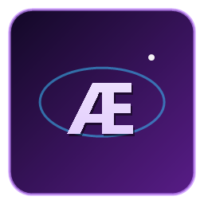

<div align="center">



# Aether

**Лёгкий и быстрый браузер на Rust**
в стиле Arc и Zen: боковая панель, живые вкладки, блокировка рекламы.

[](https://github.com/Fersiya/Aether/releases/latest)
[](https://www.rust-lang.org/)
[](#-установка)

[**⬇️ Скачать**](https://github.com/Fersiya/Aether/releases/latest) · [Возможности](#-возможности) · [Горячие клавиши](#️-горячие-клавиши) · [Как это устроено](#-как-это-устроено) · [Список изменений](CHANGELOG.md)

</div>

---

## 🌌 Зачем это

Обычные браузеры тянут за собой сотни мегабайт служебного кода. Aether берёт готовый системный движок WebView2 (Chromium из Windows) и добавляет сверху только нужное: вкладки, боковую панель, стартовую страницу и блокировку рекламы. Цель проекта одна: **быть легче и быстрее привычных браузеров**, поэтому каждая функция проверяется на влияние на память и скорость.

## ✨ Возможности

### ⚡ Скорость и память
- **Живые вкладки:** у каждой вкладки свой WebView, поэтому переключение мгновенное и страница не перезагружается.
- **Автоматическая экономия памяти:** фоновые вкладки через 20 секунд переводятся в режим низкого потребления, а при превышении 10 открытых вкладок самые старые выгружаются (вкладки со звуком и видео не трогаются).
- **Ленивое восстановление:** после перезапуска Aether поднимает только активную вкладку, остальные загружаются при первом открытии.
- **Свой диспетчер задач** на `Shift + Esc`: память и процессор по каждой вкладке и служебным процессам.

### 🛡️ Блокировка рекламы
- Запросы к ~100 рекламным и следящим доменам отсекаются на уровне сети, до загрузки.
- Пустые рекламные блоки скрываются на странице.
- Переключатель и счётчик заблокированного: стартовая страница → ⚙️ → «Блокировка рекламы». Список доменов лежит в [`assets/blocklist.txt`](assets/blocklist.txt) и легко дополняется.

### 🗂️ Вкладки и сессия
- Сессия сохраняется: после закрытия браузер открывает всё, что было.
- `Ctrl + Shift + T` возвращает закрытую вкладку, `Ctrl + Tab` переключает вкладки по кругу.
- Клик колёсиком, `target="_blank"` и `window.open()` открываются как вкладки внутри Aether, без лишних окон.

### 🎨 Интерфейс
- **Боковая панель в стиле Arc:** выезжает при наведении на левый край или по `Ctrl + B`, либо закреплена.
- **Стартовая страница:** большие часы, быстрые сервисы с логотипами, рекомендации по частым сайтам, история и пароли.
- **Неоновая полоса загрузки** и фирменный экран загрузки.
- **Настоящий полный экран видео** без панели задач Windows.

### 🎬 Для видео
- Картинка в картинке, режим «Только аудио» (разгружает GPU), медиа-меню по правой кнопке на видео.
- Автопропуск рекламы на YouTube.

## ⌨️ Горячие клавиши

| Клавиши | Действие |
| :--- | :--- |
| `Ctrl + T` | Новая вкладка |
| `Ctrl + W` | Закрыть вкладку |
| `Ctrl + Shift + T` | Вернуть закрытую вкладку |
| `Ctrl + Tab` / `Ctrl + Shift + Tab` | Следующая / предыдущая вкладка |
| `Ctrl + B` | Показать / скрыть боковую панель |
| `Ctrl + L` / `F6` | Адресная строка |
| `Ctrl + H` | Стартовая страница |
| `Ctrl + P` | Картинка в картинке |
| `Ctrl + M` | Режим «Только аудио» |
| `Shift + Esc` | Диспетчер задач браузера |
| `Alt + ←` / `Alt + →` | Назад / вперёд |
| `F5` / `Ctrl + R` | Обновить страницу |

## 📦 Установка

1. Откройте [**Releases**](https://github.com/Fersiya/Aether/releases/latest) и скачайте `aether-browser-windows.exe`.
2. Запустите файл. Установка не нужна.

Требуется Windows 10/11 с WebView2 Runtime (он уже есть в Windows 11 и в большинстве Windows 10).

### Сборка из исходников

```bash
git clone https://github.com/Fersiya/Aether.git
cd Aether
cargo build --release
```

Готовый файл появится в `target/release/aether-browser.exe`. Нужен Rust (stable) на Windows.

## 🧩 Как это устроено

```
src/
├── main.rs      окно, WebView каждой вкладки, обработка событий и IPC
├── session.rs   вкладки и сессия (чистая логика с тестами, сохраняется в session.json)
├── adblock.rs   сетевая блокировка рекламы
└── scripts.rs   подключение интерфейса к страницам
assets/
├── ui/core.js       боковая панель, адресная строка, горячие клавиши, загрузчик
├── ui/start.html    стартовая страница
└── blocklist.txt    список рекламных доменов
```

- **Rust** владеет состоянием (вкладки, сессия, настройки), а страницы получают снимок и присылают намерения через IPC.
- **tao + wry** дают окно и WebView2; сеть, память и диспетчер задач используют возможности самого WebView2.
- **Релизы** собирает GitHub Actions: пуш в `main` с новой версией в `Cargo.toml` создаёт тег и релиз с готовым `.exe`.

## 🤝 Авторы и вклад

- **[Fersiya](https://github.com/Fersiya)** — автор и владелец проекта.
- **[Claude](https://claude.com) (Anthropic)** — соавтор: оптимизация и рефакторинг, живые вкладки и сессия, экономия памяти, блокировка рекламы, релизный процесс.

Идеи и баги приносите в [Issues](https://github.com/Fersiya/Aether/issues).
